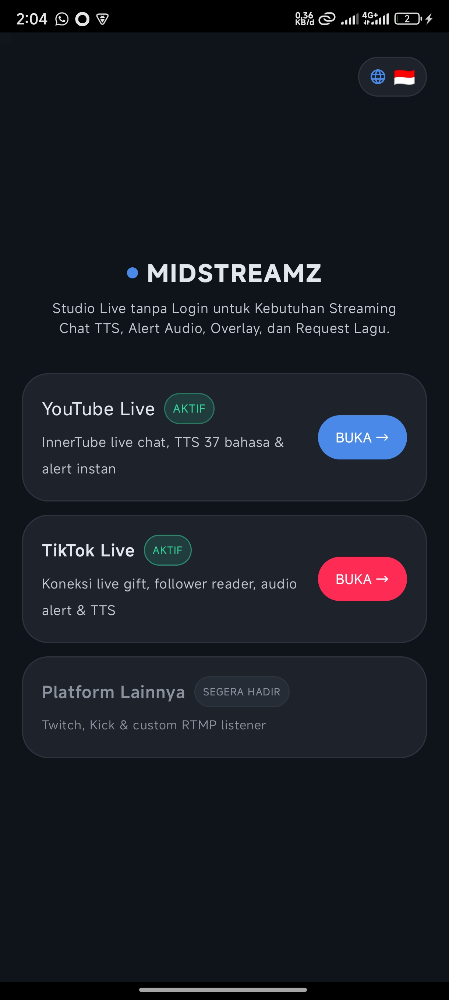
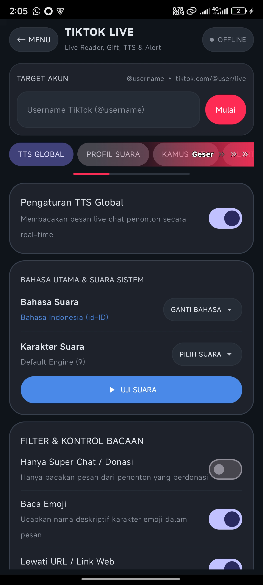
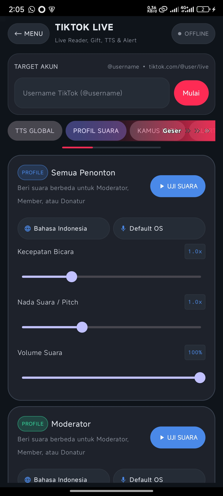
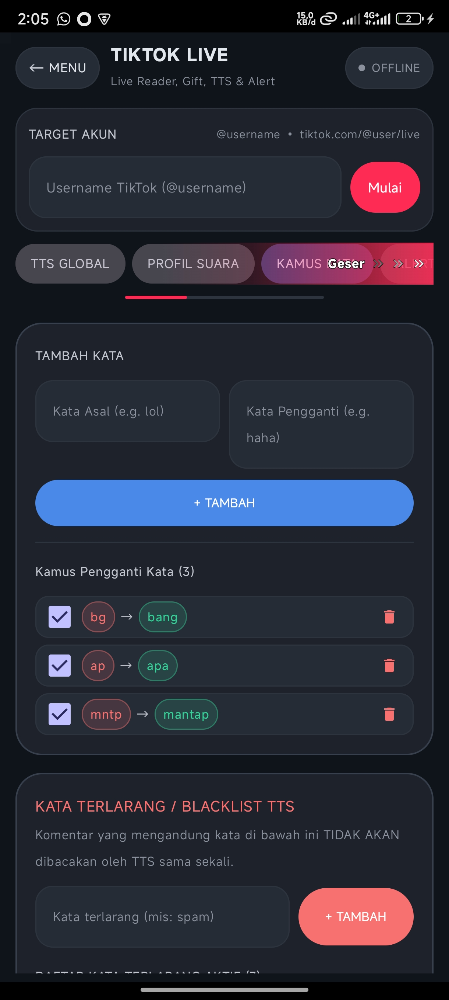
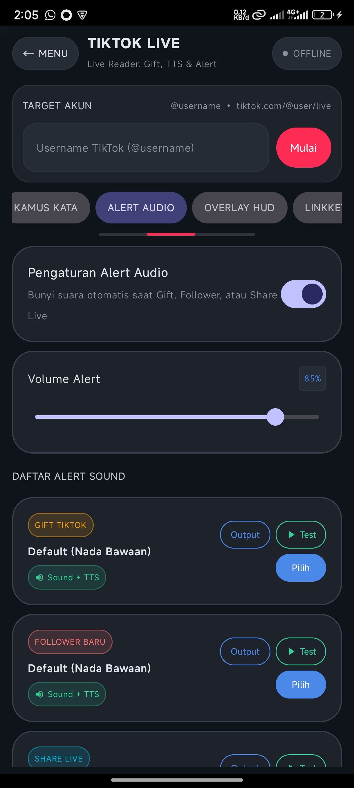
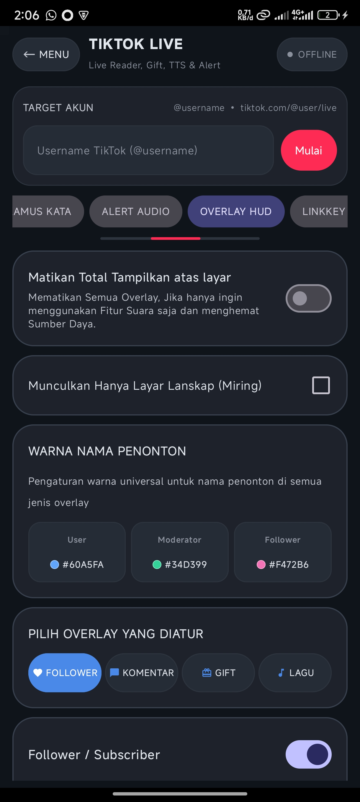
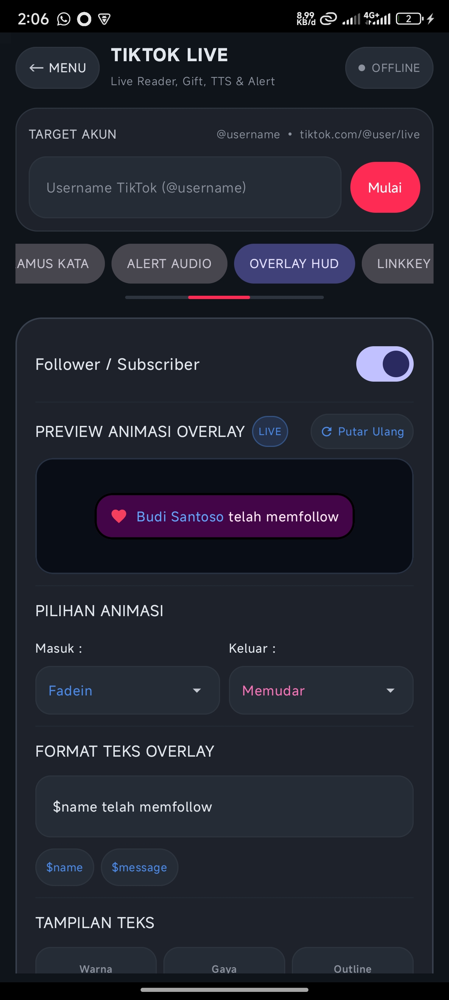
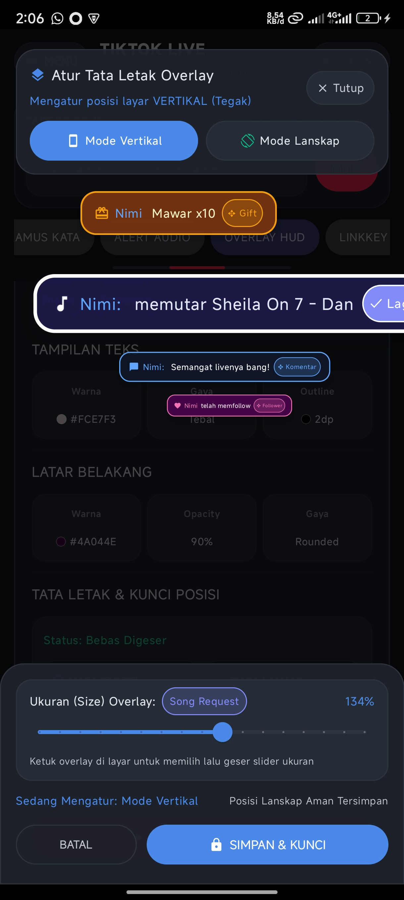
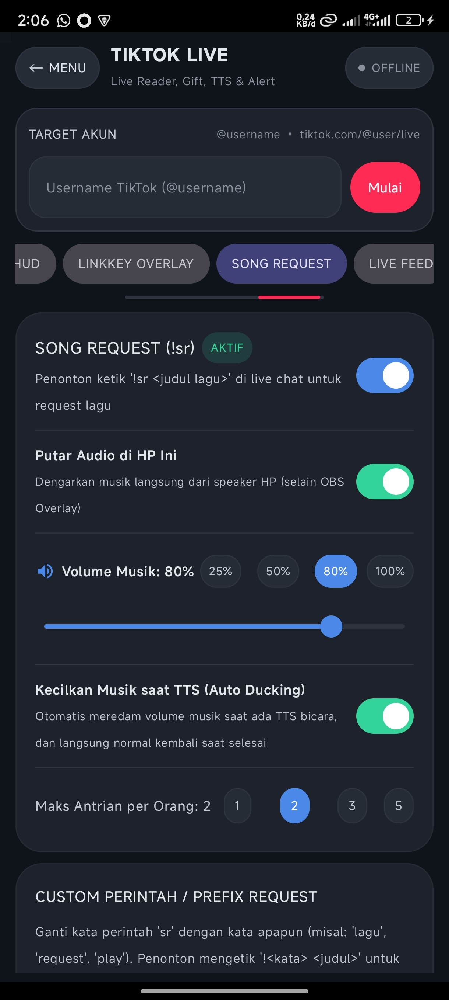
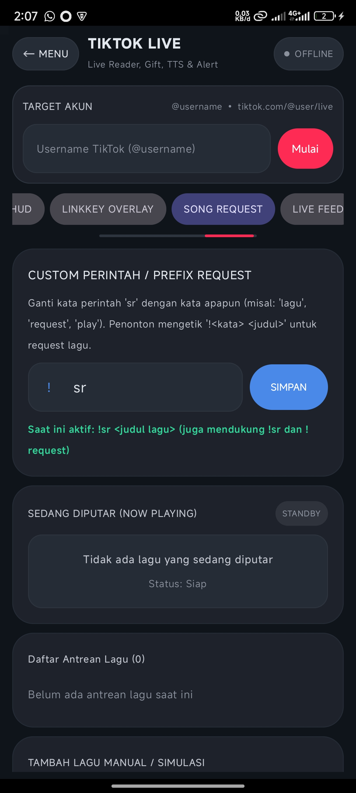

<p align="center">
  
</p>

<h1 align="center">MidStreamz - Streaming Tools</h1>

<p align="center">
  <strong>All-in-One Client-Side Live Streaming Assistant Engine for Android</strong><br />
  TTS Chat Reader &bull; Floating Overlay HUD &bull; Hardware Sound Alerts &bull; Song Request Player
</p>

<p align="center">
  <a href="https://github.com/nimidz/MidStreamz/stargazers"></a>
  <a href="https://github.com/nimidz/MidStreamz/network/members"></a>
  <a href="https://github.com/nimidz/MidStreamz/blob/main/LICENSE"></a>
  
  
  
</p>

---

## 📖 Overview

**MidStreamz** is an open-source, ultra-low-latency streaming companion tool built natively for Android streamers and mobile gaming content creators. 

Unlike traditional PC-dependent solutions, MidStreamz operates **100% locally on your smartphone**. It requires **no third-party cloud servers, no account logins, and no monthly API fees**. Simply enter your channel handle or video URL, launch the floating HUD overlay, and stream directly from mobile while keeping full control of your live chat, voice interactions, custom alerts, and viewer song requests!

---

## ✨ Key Features

### 1. 🌐 Universal Live URL Resolver (YouTube & TikTok)
- **Zero API Keys Required**: Direct client-side stream monitoring via YouTube InnerTube API and TikTok Live WebCast connector.
- **Flexible Identifier Inputs**:
  - Direct Channel Handle: `@ChannelName` or `youtube.com/@ChannelName`
  - Direct Video / Watch URL: `youtube.com/watch?v=...`, `youtu.be/...`, `youtube.com/live/...`
  - Direct Channel ID: `UC-xxxxxxxxxxxxxxxxxxxx`
  - Video ID: `jfKfPfyJRdk`
  - TikTok Username: `@streamer` with automatic live room resolution.
- **Smart Stream Auto-Reconnect**: Automatically follows YouTube live redirects and recovers connections seamlessly without dropping chat or overlay state.

### 2. 🗣️ Smart Chat Text-to-Speech (TTS)
- **Multi-Voice Engine**: Full compatibility with Android Native TTS engines (Google Speech Services, Samsung TTS, Vocalizer, etc.).
- **Voice Customization**: Individual sliders for Speech Rate (0.5x – 2.0x) and Voice Pitch (0.5x – 2.0x).
- **Multi-Role Voice Routing**: Assign distinct voices, pitches, and speeds for:
  - 👑 **SuperChat / Gifts**
  - ⭐ **Channel Members / VIPs**
  - 🛡️ **Moderators**
  - 💬 **Regular Viewers**
- **Dynamic Speech Templates**: Choose from customizable formats:
  - `{author}: {message}`
  - `{author} berkata: {message}`
  - Message only (`{message}`)
- **Anti-Spam & Delay Shield**:
  - **Max Character Cap**: Automatically truncates excessively long comments to prevent TTS monologue hijacking.
  - **Emoji Spam Filter**: Limits repetitive emojis per message.
  - **Smart Queue Purge**: Drops stale regular messages if real-time queue exceeds buffer thresholds, preventing audio lag from falling behind live video.
  - **VIP Priority Protection**: SuperChats, gifts, and member greetings are never skipped.
  - **Bot Filter**: Automatically filters out commands starting with `!` (e.g., `!sr`, `!help`, Nightbot, Moobot).
  - **Smart Localization**: Defaults automatically to your device's native language with quick multi-language switching.

### 3. 🔔 Real-Time Hardware Synthesizer Sound Alerts
- **Ultra-Low Latency**: Built-in sound synthesis running entirely on hardware audio threads.
- **Independent Audio Categories**:
  - 💰 **SuperChat & Cash Donations**: Coin Drop, Cash Register (*Ka-Ching*), Level Up
  - 🌟 **New Channel Memberships**: Welcome Bell, Fanfare, Level Up
  - 👥 **New Subscribers & Followers**: Welcome Chime, Pop Bubble
  - ❤️ **Like & Engagement Milestones**: Heart Pulse, Click
- **Custom Sound Bank & Previews**: Instant test button for every alert category with independent volume controls.

### 4. 🪟 Interactive Floating In-Game HUD Overlay
- **Draw Over Other Apps**: Fully draggable and resizable overlay window (`SYSTEM_ALERT_WINDOW`) designed for mobile games (Mobile Legends, PUBG Mobile, Free Fire, Genshin Impact, Roblox, etc.).
- **Live Chat Stream**: Real-time incoming chat with hardware-accelerated smooth scrolling at 90Hz / 120Hz.
- **Deep Visual Styling**:
  - Adjustable background opacity, blur, and custom surface color tones.
  - Font scaling, line spacing, and high-contrast text rendering.
  - Compact mode for minimal screen obstruction during intense gaming sessions.
- **Custom Layout Arranger**: Drag, hide, or rearrange HUD components (chat box, alert cards, viewer counter, song widget).

### 5. 🎵 Interactive Viewer Song Request (SR)
- **Viewer-Driven Queue**: Viewers can request songs directly in YouTube or TikTok live chat via `!sr <song title / youtube url>`.
- **Integrated Background Audio**: Built-in media player running on background service with lock screen and notification controls.
- **Streamer Control Panel**:
  - Live song queue management with reorder, skip, and pause.
  - Blacklist & profanity filters.
  - Limit maximum song duration and requests per user.

### 6. 🎨 Material You (M3) & High Refresh Rate Engine
- Built following Google's modern **Material Design 3 (M3)** with dynamic dark color schemes.
- Hardware-accelerated window pipeline (`PixelFormat.RGBA_8888`) locked to highest display mode (120Hz/90Hz) to eliminate scroll stutter.

---

## 📱 App Screenshots

<table align="center">
  <tr>
    <td align="center" width="50%">
      <br />
      <b>Platform Selector (Home)</b><br />
      <i>Choose YouTube or TikTok Live streaming tools</i>
    </td>
    <td align="center" width="50%">
      <br />
      <b>Chat TTS Settings</b><br />
      <i>Speech rate, voice pitch & monitoring controls</i>
    </td>
  </tr>
  <tr>
    <td align="center" width="50%">
      <br />
      <b>Multi-Role Voice Profiles</b><br />
      <i>Distinct voice routing for Members, SuperChats & Viewers</i>
    </td>
    <td align="center" width="50%">
      <br />
      <b>Anti-Spam & Delay Shield</b><br />
      <i>Character caps, emoji filters & queue buffer controls</i>
    </td>
  </tr>
  <tr>
    <td align="center" width="50%">
      <br />
      <b>Alert Audio Settings</b><br />
      <i>Instant test previews for SuperChat, Member & Like alerts</i>
    </td>
    <td align="center" width="50%">
      <br />
      <b>In-Game Floating HUD</b><br />
      <i>Draggable live chat overlay over mobile games</i>
    </td>
  </tr>
  <tr>
    <td align="center" width="50%">
      <br />
      <b>HUD Visual Customizer</b><br />
      <i>Fine-tune opacity, color themes, font sizes & contrast</i>
    </td>
    <td align="center" width="50%">
      <br />
      <b>Layout Arranger</b><br />
      <i>Reposition chat, alert cards, and song player on screen</i>
    </td>
  </tr>
  <tr>
    <td align="center" width="50%">
      <br />
      <b>Song Request Dashboard</b><br />
      <i>Live queue player with viewer command recognition</i>
    </td>
    <td align="center" width="50%">
      <br />
      <b>Song Request Configuration</b><br />
      <i>Duration limits, viewer quotas & audio preferences</i>
    </td>
  </tr>
</table>

---

## 🛠️ Tech Stack & Architecture

- **Language**: Kotlin 1.9.22
- **UI Framework**: Jetpack Compose with Material 3 (M3)
- **Asynchronous Execution**: Kotlin Coroutines & Flows
- **Window Management**: Android WindowManager (`TYPE_APPLICATION_OVERLAY`)
- **Speech Engine**: Android TextToSpeech API (`android.speech.tts`)
- **Audio Synthesizer**: Android AudioTrack & SoundPool
- **Network Pipeline**: OkHttp 4.12, Gson & Custom InnerTube Protocol Engine
- **Target SDK**: Android 14 (API 34) &bull; **Minimum SDK**: Android 8.0 (API 26)

---

## 🚀 Building from Source

### Prerequisites
- **JDK 17+** (JDK 21 recommended)
- **Android SDK** with Build-Tools 34.0.0+
- **Gradle 8.7+**

### Steps
1. Clone the repository:
   ```bash
   git clone https://github.com/nimidz/MidStreamz.git
   cd MidStreamz
   ```
2. Build the project with Gradle:
   ```bash
   # On Windows
   .\gradlew assembleRelease

   # On Linux / macOS
   ./gradlew assembleRelease
   ```
3. Locate the compiled APK at:
   ```
   app/build/outputs/apk/release/app-release.apk
   ```

---

## 🔒 Permissions & Security

MidStreamz is engineered with user privacy as a first-class requirement:

| Permission | Purpose |
|---|---|
| `SYSTEM_ALERT_WINDOW` | Enables drawing the floating chat HUD on top of mobile games. |
| `FOREGROUND_SERVICE` | Keeps TTS audio and live connection active when switching apps. |
| `INTERNET` | Directly connects to YouTube / TikTok live chat streams. |
| `POST_NOTIFICATIONS` | Displays service status and quick controls in the notification tray. |

> [!NOTE]
> **No personal data is collected or transmitted.** MidStreamz connects directly from your phone to public live streaming endpoints without any intermediate tracking or analytical services.

---

## 🤝 Contributing

Contributions, bug reports, and feature requests are very welcome!
1. Fork the Project.
2. Create your Feature Branch (`git checkout -b feature/AmazingFeature`).
3. Commit your Changes (`git commit -m 'Add some AmazingFeature'`).
4. Push to the Branch (`git push origin feature/AmazingFeature`).
5. Open a Pull Request.

---

## 📄 License

This project is licensed under the **GNU General Public License v3.0 (GPLv3)** - see the [LICENSE](LICENSE) file for details.

<p align="center">
  Crafted with ❤️ by <a href="https://github.com/nimidz">Nimidz</a>
</p>
